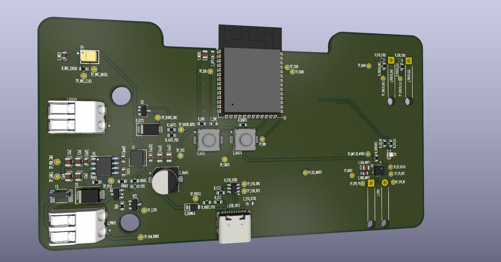
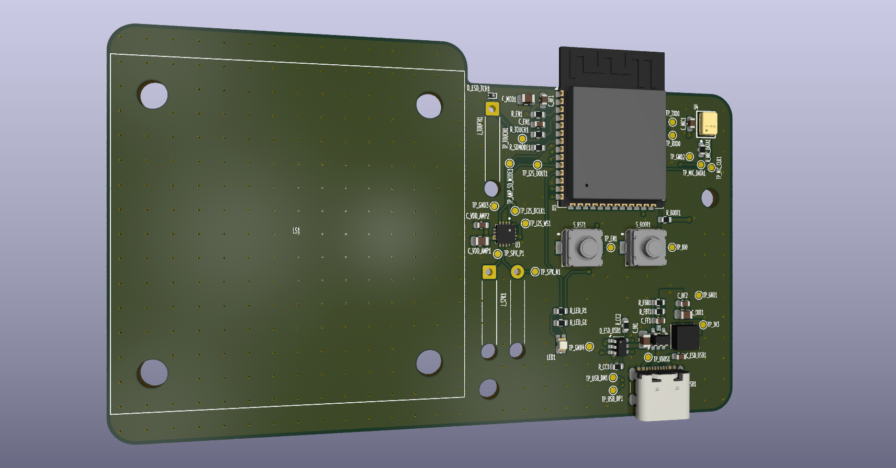

# ClearBell — Smart Doorbell (ESP32-S3, Hardware + Firmware)

🇩🇪 [Deutsche Fassung](README.md)

A doorbell system for a two-family house, developed entirely in-house — from the schematic and PCB layout to the
firmware. The project documents not only *what* was built, but the **reasoning behind each technical decision**.

> Project motto: **"Keep it simple, but working."**

**Current generation: V0.2** — a redesign around the ESP32-S3. Both boards are routed, fabricated and assembled by
PCBWay, and brought up. The first generation runs in the house and is kept in the [archive](archiv/V0.1/).

| Outdoor unit V0.2 | Indoor unit V0.2 |
|---|---|
|  |  |
| 110 × 60 mm, 4 layers, 12 V DC | 98 × 60 mm, 4 layers, USB-C |

> Most documents in this repository are written in German. English versions exist for this page, the
> [software architecture](docs/Softwarearchitektur_V0.2.en.md) and the [PCBWay review](docs/pcbway-review/README.en.md).

---

## Overview

One **outdoor unit** at the front door and two identical **indoor units** (one per flat). Ringing and opening the
door run as acknowledged, replay-protected transactions over Wi-Fi/UDP.

| Feature | V0.2 |
|---|---|
| Controller | ESP32-S3-WROOM-1-N16R8 (16 MB flash, 8 MB PSRAM), both units |
| Power, outdoor | 12 V DC (SELV) → 3.3 V with LMR33630; polyfuse, TVS diode, reverse-polarity protection |
| Power, indoor | USB-C 5 V → 3.3 V with TLV62568 |
| Programming | native USB (USB-Serial-JTAG) — indoor via the USB-C socket, outdoor via an additional service USB-C |
| Controls | capacitive touch buttons with bronze electrodes, ESD-protected |
| Audio | MAX98357A I2S class-D, Visaton K 50 FL (outdoor) / K 50 SQ (indoor) |
| Microphone | Infineon IM72D128V01 (PDM, IP57) on both units |
| Indicator | bicolour status LED (green / red, both together amber) |
| Door opener | low-side MOSFET with freewheeling diode |
| Communication | Wi-Fi + UDP via the home router, door command authenticated with HMAC-SHA256 |

---

## What changed from V0.1 — and why

- **ESP32-S3 instead of ESP32.** Native USB: flashing and logs without a UART adapter and without pressing a button.
  PSRAM for audio buffers, flash headroom for two OTA partitions, availability promised by the manufacturer until
  2033.
- **Microphone on both units** — in preparation for half-duplex intercom later. The choice fell on a PDM microphone
  that runs directly from 3.3 V: no second voltage domain, no level shifters.
- **No more SD card.** Ringtones are meant to live in flash and be replaced via the status page — one connector and
  one mechanical failure path fewer.
- **4 layers instead of 2.** Both inner layers are ground; every signal layer has its reference plane directly
  underneath. Reason: at 1.6 mm the thick core inevitably sits between the inner layers, so a dedicated power layer
  would add hardly any plane capacitance. Known deviation (indoor unit): a 3.3 V trace runs on In2 and splits the
  ground plane there. USB D+/D−, I2S_BCLK, I2S_WS and LED_RED on the bottom side cross this slot, so their return
  current has to detour. Functionally harmless at USB Full Speed, but avoidable from an EMC point of view. Fix in
  V0.3: move the trace to an outer layer and close In2 again.
- **Vias next to the pads, not in them.** A via in a pad wicks solder away during reflow. DRC does not check this —
  hence custom check scripts over all vias and pads.
- **Touch without shield/guard.** The bronze electrodes stay freely accessible. An adaptive baseline in the firmware
  handles drift from humidity; the ESD diodes have only 0.5 pF to keep the sensitivity.
- **Door-opener freewheeling diode rated for 1 A** (SMA package). V0.1 used a signal diode there that was too small
  for the opener's coil current.

The radio transport stays Wi-Fi/UDP via the router — ESP-NOW was measured at the real mounting locations and
rejected, see [`docs/Funkvalidierung_ESPNOW.md`](docs/Funkvalidierung_ESPNOW.md) (German).

---

## Repository structure

```
clearbell/
├── hardware/                  V0.2, KiCad 10
│   ├── Ausseneinheit/         outdoor unit: schematic, PCB, Schaltplan.pdf
│   │   └── fertigung/         manufacturing: Gerber ZIP, BOM, pick-and-place data
│   └── Inneneinheit/          indoor unit: same
├── firmware/                  V0.2 firmware (ESP-IDF), tools, test log
├── docs/
│   ├── img/                   3D views V0.2
│   ├── pcbway-review/         review of the PCBWay boards with photos (DE/EN)
│   ├── Softwarearchitektur_V0.2.md      firmware architecture, runtime, security
│   ├── Softwarearchitektur_V0.2.en.md   the same in English
│   └── Funkvalidierung_ESPNOW.md        ESP-NOW radio validation
└── archiv/V0.1/               first generation: hardware, firmware, dashboard, documentation
```

---

## Manufacturing

| | |
|---|---|
| Stack-up | 4 layers, 1.6 mm, FR-4 (S1000H, TG150), 1 oz outer and inner, no impedance control |
| Finish | lead-free HASL, green solder mask, white silkscreen (top only) |
| Assembly | single-sided, machine-placed — outdoor 56, indoor 33 parts |
| BOM | per unit in `fertigung/`, with a "substitute allowed" column (no substitutes for critical parts) |
| Checks | DRC and ERC clean |

### Experience with PCBWay

**[PCBWay](https://www.pcbway.com)** fabricated and assembled the V0.2 boards. The PCBs were produced as part of a
sponsorship; I paid for assembly and components myself.

My verdict as a PCB design engineer who handles boards almost every day at work:

- **PCBs very good:** solder mask and silkscreen clean and accurately registered, even HASL finish, no delamination,
  boards flat and burr-free.
- **Assembly very good:** all parts correctly placed and oriented, critical areas (USB-C, QFN audio amplifier,
  ESP32-S3 module) soldered without bridges.
- **Worked first time:** bring-up and a 24-hour endurance test without a single manufacturing defect.
- **Communication very good:** sensible engineering questions on the BOM, order progress traceable step by step on
  the website.

I would use PCBWay again.

📋 [**Full review with photos**](docs/pcbway-review/README.en.md) · 🇩🇪 [Deutsche Fassung](docs/pcbway-review/README.md)

---

## Firmware

The **V0.2 firmware** lives in [`firmware/`](firmware/README.md) (German): an ESP-IDF project (v5.5.5) with the
Arduino core as a component, one image for the outdoor and one for the indoor unit. It is ported, tested on all
three boards and was signed off on 12 Nov 2026. Among other things it includes an authenticated protocol with
sessions, a challenge–response door command, touch with adaptive baseline, a status page protected by a device
password, remote door opening via push notification to the phone, setup without a PC via its own Wi-Fi access
point, and signed updates with rollback. The status of each step and the evidence are in the
[firmware README](firmware/README.md) and the [test log](firmware/docs/Testprotokoll.md) (both German). Still open:
the 72-hour endurance test and a few manual checks.

The first-generation firmware (Arduino, acknowledged UDP protocol, HMAC-secured door command, custom WAV player)
still runs in the house and is in [`archiv/V0.1/firmware/`](archiv/V0.1/firmware/).

**How the V0.2 firmware is built and why is described in a separate document:** architecture and execution model,
authenticated protocol, boot sequence and runtime behaviour, data storage and flash layout, a security chapter with
threat model, **openly stated residual risks** and a mapping to ETSI EN 303 645, error handling, porting plan and test
strategy. The current revision 2 is the result of a critical review of the first draft with 29 findings.

📄 [**Software architecture V0.2**](docs/Softwarearchitektur_V0.2.en.md) · 🇩🇪 [Deutsche Fassung](docs/Softwarearchitektur_V0.2.md)

What is already running and what is still a draft is marked throughout — as are the five behavioural questions that
are deliberately left open.

---

## Status

- **V0.2:** boards delivered by PCBWay on 24 Oct 2026, PCBs and assembly without defects
  ([review](docs/pcbway-review/README.en.md)). Bring-up of both units passed (power, USB/flash, audio, microphone,
  touch, door output, Wi-Fi). The new [firmware](firmware/README.md) is ported and was signed off on 12 Nov 2026; all
  three boards (one outdoor, two indoor units) ran for 24 hours without a reset and without a failed ring. Hardening
  is currently in progress (encrypted key storage, security tests). Still open: a test with the real door opener and
  a radio test at the mounting location, once the enclosures are built.
- **V0.1:** runs in the house; Wi-Fi/UDP transport passed its endurance test without packet loss.

---

## Notes

- **Datasheets** of the components are **not** included for copyright reasons — they are freely available from the
  manufacturers; the part numbers are in the BOMs.
- The custom KiCad library is embedded in the schematic and PCB. Most **3D models** come from the KiCad standard
  library and appear in any KiCad 10 installation; ten parts use manufacturer models (Littelfuse, Panasonic,
  Infineon, TI, WAGO) that are not included for licensing reasons — the 3D view shows only their pads.
- Network names, passwords and cryptographic keys are not in the repository.
- Please report **security vulnerabilities** confidentially, not as an issue — see [`SECURITY.md`](SECURITY.md).

## License

[MIT](LICENSE) © 2026 André Körner
